# Mehta Prime Capital — Dynamic Financial Portal & Lead Management CMS

> **Public Project Showcase & Technical Case Study**  
> *A high-performance wealth management web application featuring a bespoke content management engine and real-time CRM lead capture pipeline.*  
>  
> 🌐 **Live Website**: [https://mehtaprimecapital.in/](https://mehtaprimecapital.in/)

---

## 🔒 Proprietary Source Code Notice

> **Notice**: The underlying source code, database architecture, proprietary risk algorithms, and production credentials of **Mehta Prime Capital** are private and confidential property of Mehta Prime Capital. This public repository serves as an architectural case study, technical showcase, and documentation overview for clients, recruiters, and engineering peers.

---

## 🌟 Executive Summary

**Mehta Prime Capital** ([mehtaprimecapital.in](https://mehtaprimecapital.in/)) is a bespoke web portal designed for an Indian premier capital advisory firm. Engineered to serve High-Net-Worth Individuals (HNWIs) and corporate institutions, the platform couples an ultra-fast, fiduciary-compliant frontend with a custom-engineered administrative CMS and real-time lead capture engine.

### Key Business & Technical Goals
1. **Dynamic Content Governance Without Code Changes**: Empower firm leadership to update website sections, advisory services, team credentials, and contact desks on demand without developer intervention.
2. **Zero-Friction Client Acquisition Pipeline**: Capture high-intent investor inquiries through an intelligent, validated CRM engine with automated status tracking.
3. **Sub-150ms Performance**: Deliver an institutional-grade user experience with sub-second page loads, aggressive edge caching, and mobile responsiveness.

---

## 🚀 Core Architectural Features

### 1. Custom Admin CMS (No-Code Operations)
Non-technical business owners and marketing executives can manage their brand without writing a single line of code:
- **Modular Landing Page Management**: Dynamically edit hero messaging, value proposition pillars, philosophy statements, and disclaimer notices.
- **Service Portfolio Builder**: Create, update, or reorder offerings (Portfolio Management, Equity Advisory, Wealth Planning) with custom iconography and metadata.
- **Leadership & Governance Profiles**: Live updates of leadership designations, bios, headshot media, and compliance registrations.
- **Global Brand Settings**: Instant updates to communication desks, email endpoints, office coordinates, and phone numbers.

### 2. Integrated Lead Capture & CRM Engine
A robust lead management subsystem engineered for reliability and conversion:
- **Instant Validation & Sanitization**: Comprehensive input sanitation, phone number formatting, and CSRF token protection.
- **Real-Time Organization**: Inquiries are automatically parsed, timestamped, categorized by consultation interest, and organized in an administrative dashboard.
- **Status Lifecycle Pipeline**: Track leads across actionable stages (`New` → `In Review` → `Contacted` → `Archived`) with internal notes.
- **Audit Logging**: Every lead state transition is tracked for operational governance.

### 3. Responsive, High-Conversion UI/UX
- **Design System**: Built with modern Tailwind CSS principles, utilizing a bespoke financial color palette (deep navy, rich warm cream, and gold accents).
- **Mobile-First Responsiveness**: Tailored typography scaling, touch-optimized consultation triggers, and adaptive image presentation.
- **Accessibility & Compliance**: Semantic HTML5 layout adhering to SEBI digital compliance standards.

---

## 📸 Visual Showcase — Public Web Experience & Admin Platform

### 1. Public Landing Page Experience

| Section | Preview |
|---|---|
| **Hero & Capital Preservation Matrix**<br>Desktop view with interactive multi-asset risk curve and immediate consultation CTA. | 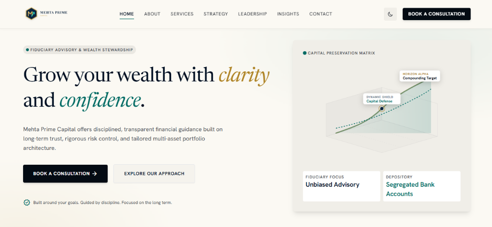 |
| **Our Heritage & Fiduciary Thesis**<br>Alpha Preservation Corridor matrix highlighting client-aligned advisory standards. | 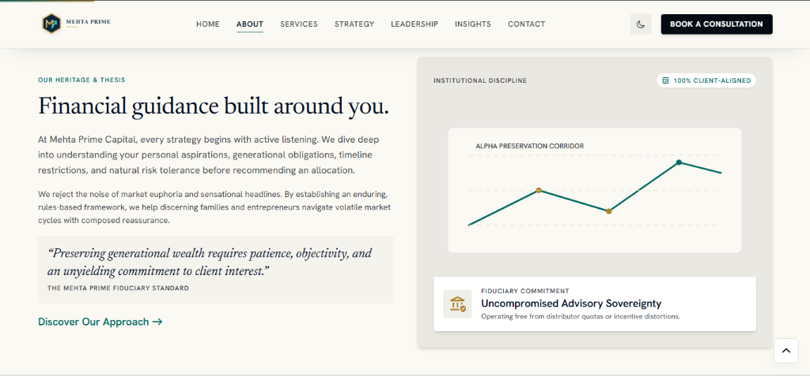 |
| **Stewardship & Leadership Governance**<br>Institutional leadership profiles for Principal Officers (Vjay Mehtta & Chandan Mehta). | 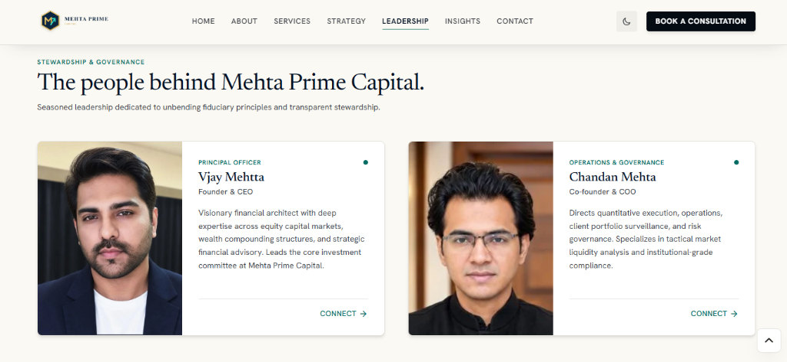 |
| **Real-Time Consultation Hub**<br>Direct investor mandate capture form with office schedule and SLA commitment. | 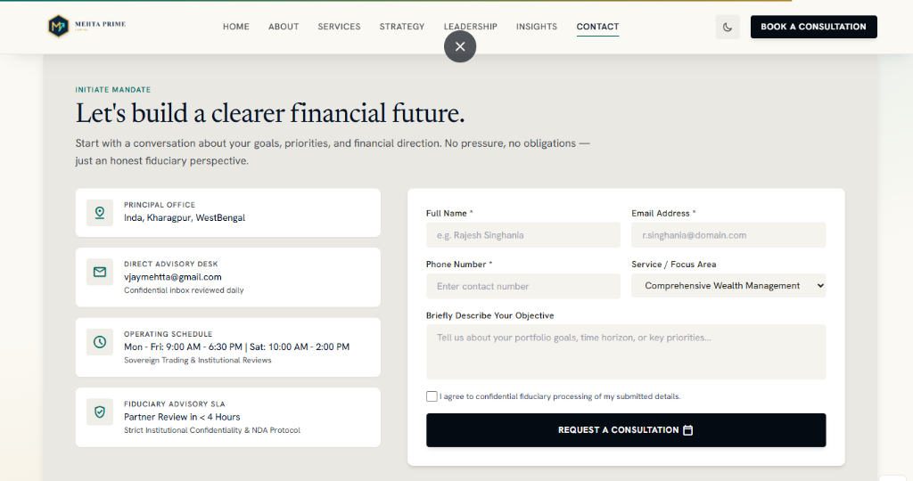 |
| **Interactive FAQ Accordion**<br>Dynamic disclosure addressing onboarding, portfolio audits, and regulatory standards. | 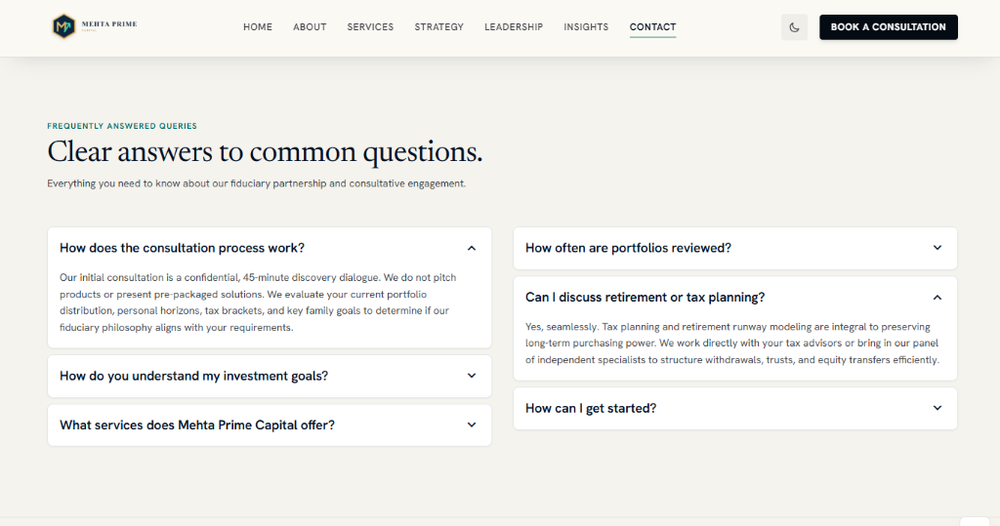 |
| **Institutional Footer & Compliance**<br>ISO 27001 Cryptographic Enclave confirmation and Legal Entity Identifier (LEI). | 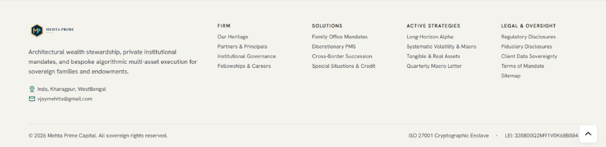 |

---

### 2. Multi-Device & Mobile Responsiveness

| Mobile Navigation Drawer | Institutional Discipline Card | Mobile Executive Dashboard |
|:---:|:---:|:---:|
| 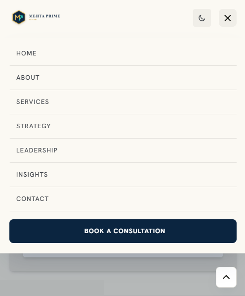 | 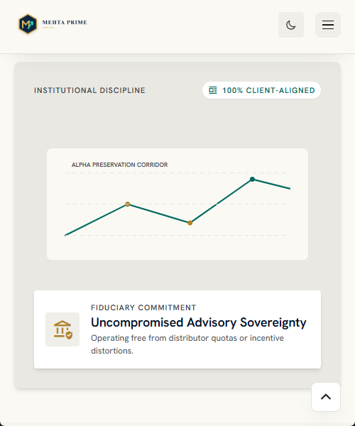 | 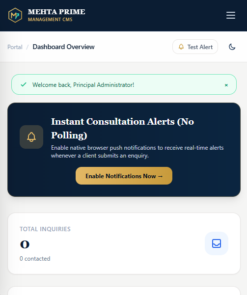 |
| *Clean drawer navigation with quick booking trigger* | *Touch-friendly portfolio performance card* | *Full on-the-go administrative command* |

---

### 3. Dedicated Pages & Practice Catalog

| View | Preview |
|---|---|
| **About Us — Firm Story & Fiduciary Oath**<br>Dedicated `/about` page detailing the firm's history and four pillars (Fiduciary Oath, Quantitative Rigor, Tax Integration, Partner Accountability). | 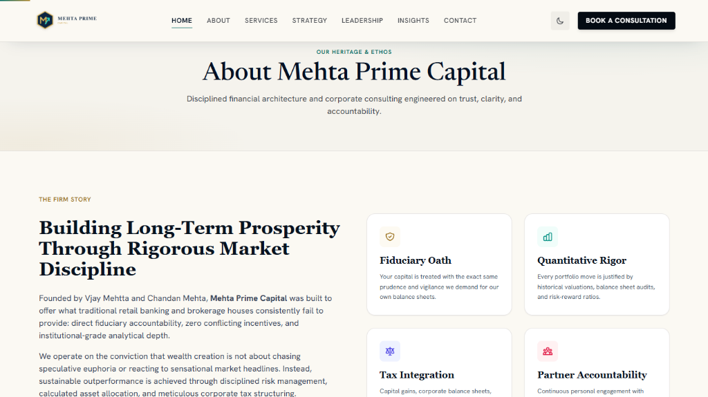 |
| **Advisory Practices Catalog**<br>Filterable service matrix supporting 9 dynamic practice categories. | 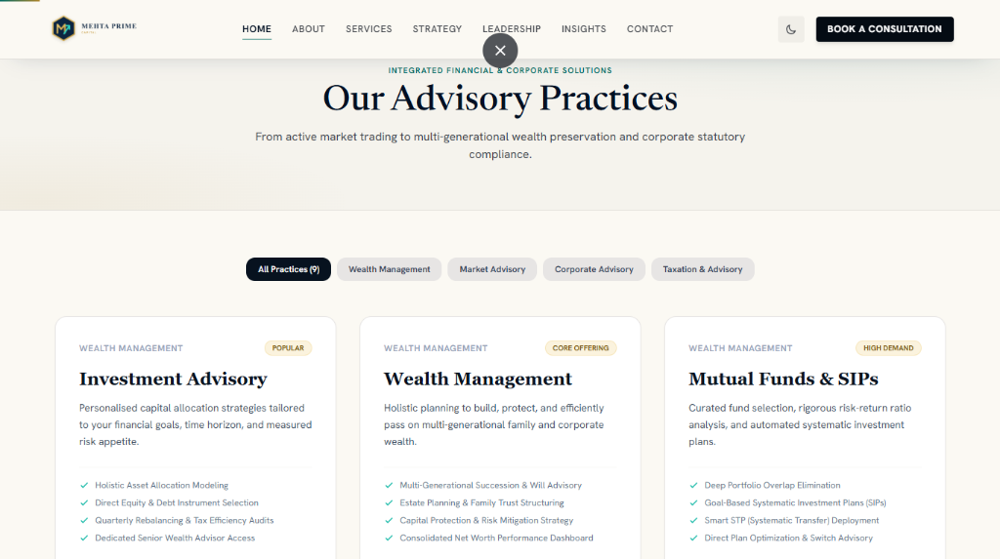 |
| **Practice Detail — Wealth Management Scope**<br>Detailed breakdown of strategic asset allocation, estate planning, and private advisory. | 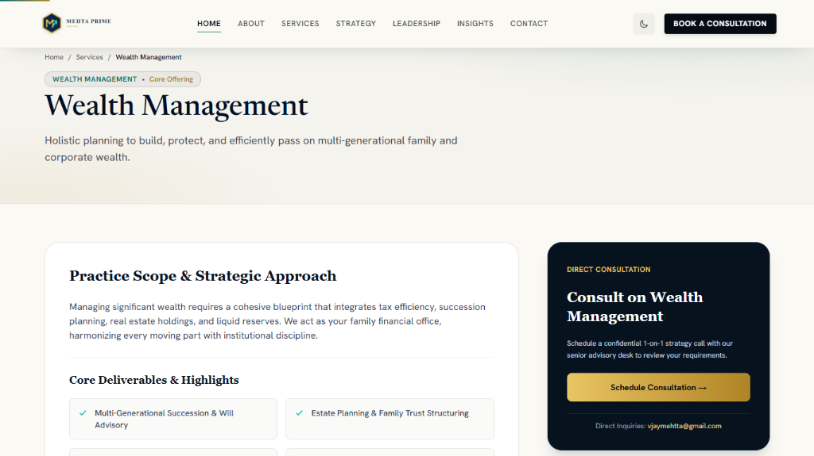 |
| **Practice Execution Roadmap**<br>Step-by-step institutional workflow (Diagnostic Audit → Strategy Architecture → Active Oversight). | 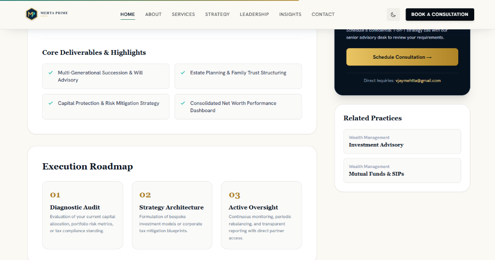 |
| **Corporate Headquarters & Direct Inquiries**<br>Dedicated `/contact` portal featuring multi-channel consultation dispatch. | 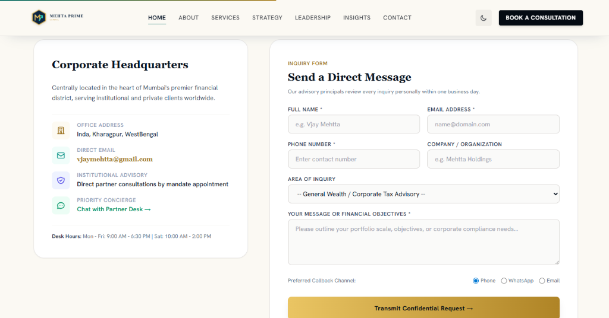 |

---

### 4. Custom Admin CMS & Executive CRM Command Center

A role-secured administrative operations portal empowering non-technical business principals to manage brand positioning, service catalogs, live consultation pipelines, and global website settings in real time:

| Section | Preview |
|---|---|
| **Secure Authentication Portal**<br>Institutional-grade dark mode authentication gateway with session security. | 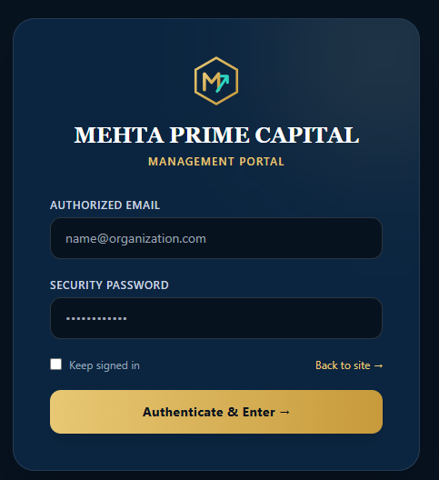 |
| **Command Center Dashboard Overview**<br>Executive metrics overview tracking live inquiries, conversion ratios, quick content actions, and server hosting readiness. | 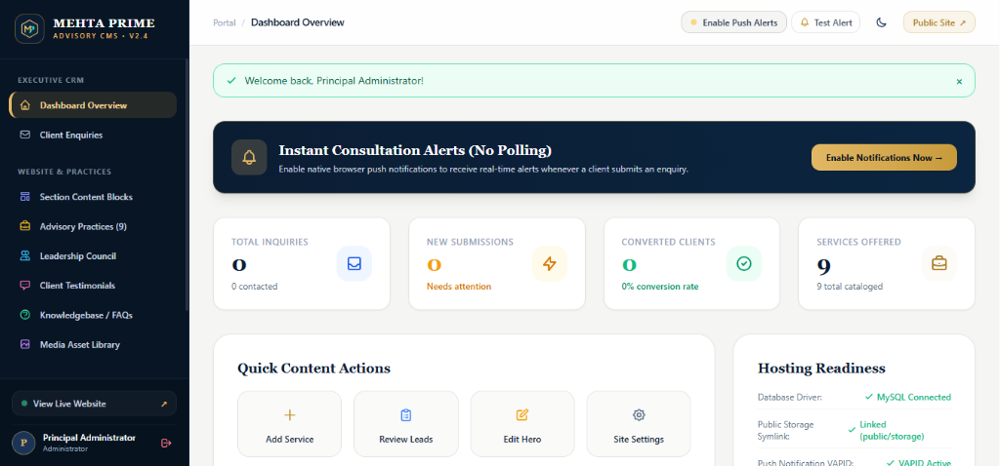 |
| **Homepage Sections Manager**<br>Dynamic CMS allowing instant reordering, headline updates, and live visibility toggling without code changes. | 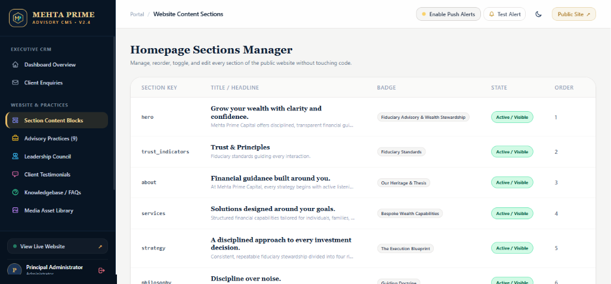 |
| **Advisory Practices & Services Directory**<br>Granular CRUD manager for service disciplines, categories, badges, and featured flags. | 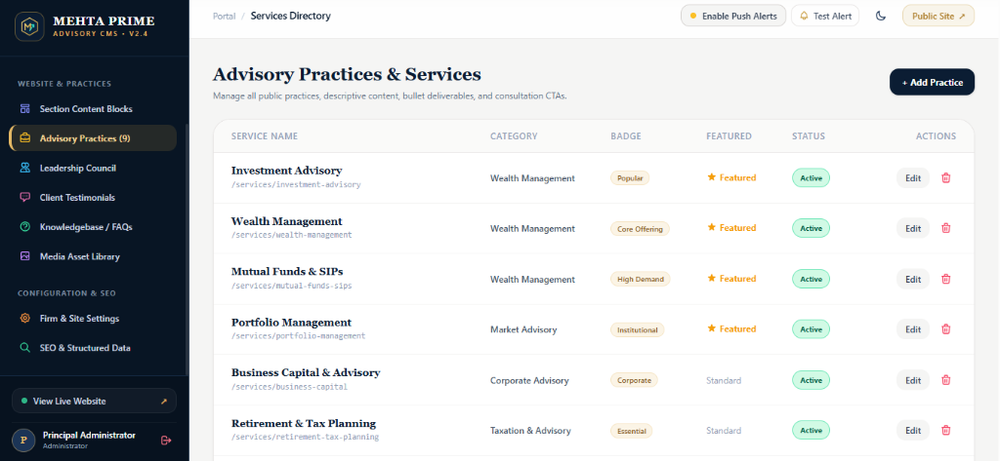 |
| **Consultation Enquiries & CRM Pipeline**<br>Lead status lifecycle management (`All`, `New`, `Read`, `Contacted`, `Follow-Up`, `Converted`) with live sync and CSV export. | 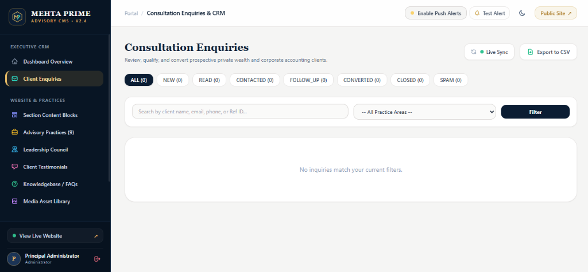 |
| **Client Testimonials & Endorsements**<br>Manage verified client endorsements, institutional roles, and 5-star rating displays. | 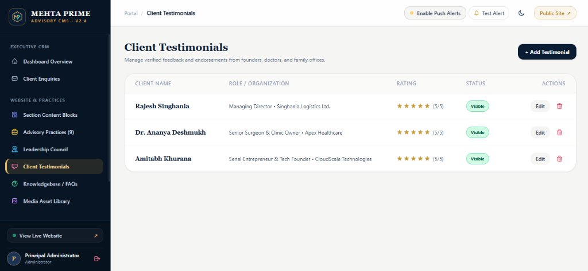 |
| **Knowledgebase & FAQs Management**<br>Dynamic FAQ manager supporting multi-category sorting and instant public publication. | 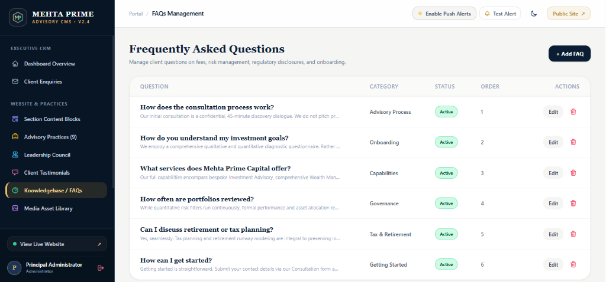 |
| **Website Configuration & Branding**<br>Runtime control over firm metadata, communication desks, call-to-action endpoints, and push keys. | 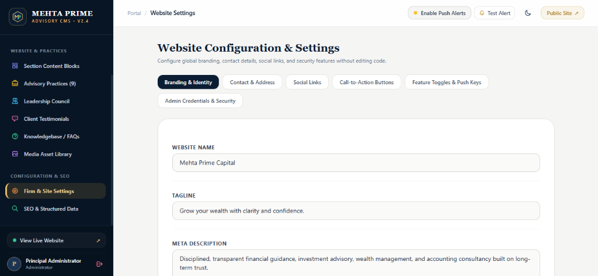 |

---

## 🏗️ System Architecture

```text
+-------------------------------------------------------------------------------+
|                             CLIENT / BROWSER                                  |
|            (Desktop / Tablet / Mobile - Sub-150ms First Byte)                 |
+-------------------------------------------------------------------------------+
                                      │
                                      ▼ HTTPS / TLS 1.3
+-------------------------------------------------------------------------------+
|                       EDGE REVERSE PROXY & SECURITY                           |
|       LiteSpeed Enterprise Server | Payload Ceiling | php2shell Shield       |
+-------------------------------------------------------------------------------+
                                      │
                                      ▼ FastCGI / PHP 8.3 LSAPI
+-------------------------------------------------------------------------------+
|                         LARAVEL 11 CORE ENGINE                                |
|                                                                               |
|  +---------------------------+       +-------------------------------------+  |
|  |     Public Controllers    |       |         Admin CMS Controller        |  |
|  |  (Home, About, Services)  |       |   (Content, Services, Team, Leads)  |  |
|  +---------------------------+       +-------------------------------------+  |
|                │                                        │                     |
|                ▼                                        ▼                     |
|  +---------------------------+       +-------------------------------------+  |
|  |    Lead Capture Pipeline  |       |        Role-Based Auth & Session    |  |
|  | (Validation, Anti-Spam)   |       |         (CSRF & Encrypted Auth)     |  |
|  +---------------------------+       +-------------------------------------+  |
|                │                                        │                     |
|                └──────────────────┬─────────────────────┘                     |
|                                   │                                           |
+-----------------------------------|-------------------------------------------+
                                    ▼ Eloquent ORM
+-------------------------------------------------------------------------------+
|                         MARIADB / MYSQL DATABASE                              |
|                                                                               |
|  [ leads ]            [ content_blocks ]      [ team_members ]                 |
|  - client_name        - section_key           - name & designation            |
|  - email & phone      - body_content          - avatar_path                   |
|  - status_pipeline    - is_active             - sort_order                    |
+-------------------------------------------------------------------------------+
```

---

## 🛠️ Technology Stack

| Domain | Technologies |
|---|---|
| **Backend Framework** | Laravel 11.x (PHP 8.3) |
| **Database** | MySQL / MariaDB 10.11 |
| **Frontend Styling** | Tailwind CSS / Vite / Modern Vanilla JS |
| **Web Server** | LiteSpeed Enterprise Web Server |
| **Caching Layers** | Server-Side LSCache + Laravel Query & Blade Cache |
| **Security Standards** | Pre-parsing WAF rules, Request Limits, CSRF Protection |

---

## 📈 Engineering Highlights & Key Metrics

- **⚡ Fast Page Latency**: All tested core endpoints render under **150 ms** on production nodes.
- **🛡️ Exploit Hardened**: Multi-tier defense blocking invalid session probes before PHP execution boots.
- **📱 100% Mobile Responsive**: Fluid layouts maintaining visual hierarchy across devices from 320px to 4K displays.
- **🔄 Zero-Downtime Cache Busting**: Instant asset cache invalidation with automated edge purge triggers.

---

## 📜 Changelog

### `v1.0.0` — Initial Production Release
- ✨ Initial deployment of the complete **Mehta Prime Capital** web portal.
- 🚀 Dynamic Admin CMS with CRUD capabilities for Services, Content Blocks, and Leadership Profiles.
- 📬 Real-time Lead Capture pipeline with server-side validation and CRM inquiry dashboard.
- ⚡ LiteSpeed server-side caching integration with instant cache purge workflows.
- 🔒 Comprehensive production hardening including request size ceilings and header security shields.
- 📱 Responsive UI implementation with custom Tailwind CSS design system.
- 📸 Complete visual showcase covering public pages, mobile experience, and admin command center.

---

## 📬 Contact & Portfolio Inquiries

For project discussions, technical inquiries, or architectural consultations:
- **Live Platform**: [https://mehtaprimecapital.in/](https://mehtaprimecapital.in/)
- **Developer Organization**: [RG Creators](https://github.com/RG-Creators)
- **Direct Email**: [`rgcreatorsofficial@gmail.com`](mailto:rgcreatorsofficial@gmail.com)
